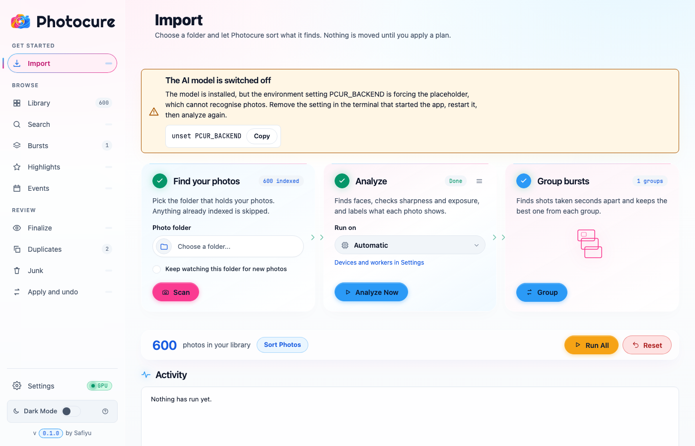
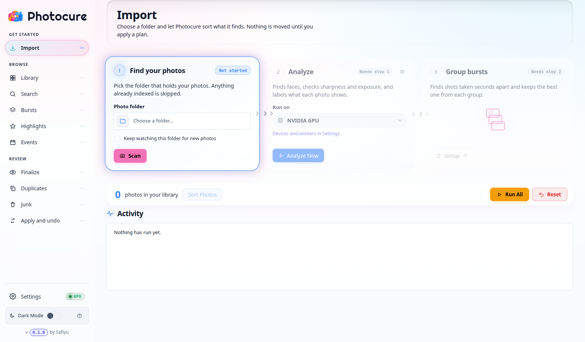

<p align="center"></p>

# Photocure

**Sort, cull and tidy your photo library, privately, on your own computer.**

Photocure looks at every photo, works out what it shows, finds the best shot in each burst, spots duplicates and clutter, and files everything into a clean folder structure. Nothing is uploaded anywhere, and nothing on your disk changes until you say so. Every change can be undone.

<p align="center">
  
  
</p>

## Contents

- [What Photocure does for you](#what-photocure-does-for-you)
- [What you need](#what-you-need)
- [Install and first start](#install-and-first-start)
- [Using Photocure day to day](#using-photocure-day-to-day)
- [A tour of the app](#a-tour-of-the-app)
- [Keyboard shortcuts](#keyboard-shortcuts)
- [Your photos stay safe](#your-photos-stay-safe)
- [Optional extras](#optional-extras)
- [Command line](#command-line)
- [Troubleshooting](#troubleshooting)

---

## What Photocure does for you

- **Sorts photos by what they show.** People, food, animals, scenery, plants, vehicles, buildings, products, art and more. It recognizes photos by looking at them, so you do not tag anything by hand.
- **Finds the best photo in every burst.** When you took ten frames in a row, it keeps the sharpest one and tells you which others are spare.
- **Catches blinks, and group shots where someone blinked.** For group photos it checks every face in every frame and points out the frame where everyone's eyes are open. If no frame is perfect, it tells you which two to combine.
- **Finds duplicates.** Identical files and look-alike photos, with a suggested one to keep and how much space you would free.
- **Keeps useful reference shots apart.** Receipts, whiteboards and notes, screenshots, device labels and serial numbers, parking spot signs and medicine packaging go to their own Utility tab, instead of cluttering your photos or being treated as junk.
- **Finds your best photos.** Ranks your photos by how appealing they look, boosted by your stars and favourites, and learns your personal taste over time.
- **Builds event stories.** For a trip or party, it picks a balanced set: wide scene-setters, close-up details, action and atmosphere, rather than twenty near-identical medium shots.
- **Finds photos by description.** Type "dog on the beach" or "birthday cake" and it finds them.
- **Organizes your files safely.** Preview exactly what will move, apply it, and undo it with one click if you change your mind.

Photocure works with JPEG, PNG, WebP, TIFF, HEIC and the common camera RAW formats (CR2, NEF, ARW, DNG). Large libraries are fine: a library of 100,000 photos still scrolls smoothly.

## What you need

- A Mac, Linux or Windows computer. Apple Silicon Macs and NVIDIA graphics cards make analysis much faster, but a plain processor works too. (Windows graphics-card support is best effort.)
- Some patience for the first set-up, which is mostly waiting for the AI model to download. Allow a few gigabytes of free disk space for it.
- An internet connection **for the first set-up only**. After that, Photocure works fully offline.
- Python 3.11 or newer, unless you use the Debian/Ubuntu package or Docker below.

## Install and first start

Pick the way that suits you. All three end with the same app in your web browser.

### Option 1: Debian or Ubuntu (easiest on Linux)

1. Download and install the package:

   ```bash
   curl -LO https://github.com/safiyu/photocure/releases/latest/download/photocure_amd64.deb
   sudo apt install ./photocure_amd64.deb
   ```

2. Run the one-time set-up:

   ```bash
   photocure setup
   ```

### Option 2: Mac, Windows or any Linux (from source)

1. Install [Python 3.11 or newer](https://www.python.org/downloads/) if you do not have it.
2. Download Photocure and open a terminal in its folder:

   ```bash
   git clone https://github.com/safiyu/photocure.git
   cd photocure
   ```

3. Create a private Python environment and install:

   ```bash
   python3 -m venv .venv
   source .venv/bin/activate          # on Windows: .venv\Scripts\activate
   pip install -e .
   ```

4. Run the one-time set-up:

   ```bash
   photocure setup
   ```

### What `photocure setup` does

It looks at your computer, installs the AI parts that fit it (using your graphics card if there is a supported one), downloads the model, checks that everything works, and opens Photocure in your browser. It asks before downloading anything.

| If you want to... | Add this |
|---|---|
| Skip the confirmation question | `--yes` |
| See what it would do without doing it | `--dry-run` |
| Ignore your graphics card and use the processor | `--cpu-only` |
| Skip blink detection | `--no-faces` |
| Set up but do not open the browser | `--no-open` |

### Option 3: Docker

Good for a NAS or a server. Replace the two paths with your own folders: the photos to read, and where organized photos should go.

```bash
PHOTOS_DIR=/path/to/photos OUTPUT_DIR=/path/to/organized docker compose up
```

Then open <http://localhost:8080/> in your browser. The first start downloads the AI parts into a saved volume, so later starts are quick.

For faster analysis, use the file that matches your graphics card, for example for NVIDIA (this needs the NVIDIA Container Toolkit):

```bash
PHOTOS_DIR=/path/to/photos OUTPUT_DIR=/path/to/organized docker compose -f docker-compose.yml -f docker-compose.gpu.yml up
```

For AMD use `docker-compose.rocm.yml` in place of `docker-compose.gpu.yml`, and for Intel use `docker-compose.intel.yml`.

#### Portainer / Home Server Stack
If you are deploying as a stack in **Portainer** or on a remote server, use the sample [docker-compose.stack.yml](docker-compose.stack.yml) file. It uses the pre-built `safiyu/photocure:latest` image and includes pre-configured environment variables (`PCUR_AUTH_TOKEN`, `PCUR_ALLOWED_HOSTS=*`, user IDs, and volumes).

On a Mac, Docker cannot use the Mac graphics chip. For full speed on a Mac, use Option 2.

## Using Photocure day to day

Start it any time with:

```bash
photocure start
```

(or `./start.sh` from the Photocure folder). Your browser opens at <http://localhost:8080/>. To stop it, press `Ctrl+C` in the terminal, or run `photocure stop`.

If the page asks you to sign in, paste the one-time code that Photocure printed in the terminal where you started it.

**A typical first session:**

1. **Import:** pick your photo folder and press **Scan**. Photocure lists your photos without changing them.
2. **Analyze:** press **Analyze Now**. It reads each photo, groups burst shots and sorts everything into categories. This is the slow step, and you can keep browsing while it runs. Analyze only reads photos that were never analyzed. After changing categories use **Re-check rules** (fast), or **Reanalyse everything** to run the AI again on every photo.
3. **Look around:** open Library, Bursts, Duplicates, Utility and Highlights to see what it found.
4. **Tidy up:** fix anything it was unsure about in Finalize, and decide which duplicates to keep.
5. **Organize:** in Apply and undo, choose where the organized photos go, preview, and apply.

Adding more photos later? The big pink **Scan** button is always the next step when everything is up to date, then **Analyze Now** for the new ones. A line under the library count always tells you what to do next.

## A tour of the app

The menu on the left has everything. The little numbers show how many photos are in each place.

### Import

Choose a folder and press **Scan**, then **Analyze Now**. **Run All** does both in one go. Tick **Keep watching this folder for new photos** and Photocure will pick up new arrivals by itself. The progress bar at the top shows what is running, and you can stop it. The **Activity** panel below keeps a timeline of everything that happened, with a filter for problems and a Clear button. **Reset** empties Photocure's own records only, never your photo files.

### Library

Every photo, oldest first. Narrow it down by category, camera, rating, country, favourites, or a date range (quick buttons for this year, last 90 days and last 30 days). The size slider changes thumbnail size. Click a photo to open it large, rate it, mark it as a favourite, change its category or lock it so a re-analysis never changes it. Click the tick on photos to select several and move them together.

**Mark for delete.** Every photo, in every section, has a small trash icon (and the photo viewer and the selection bar have a **Mark for delete** button). A marked photo is dimmed and tagged, and it is left out of the result when you apply. With the trash option on (the default) it is moved to a trash folder you can restore or purge later; otherwise, or when you copy instead of move, your original stays where it is. Nothing is deleted just by marking, and unmarked photos are never removed. To mark everything Photocure flags as junk in one go, tick **Approve all proposed deletions** before you analyze.

**Clean export.** With photos selected, press **Clean export** to make copies that are safe to share. Location, camera serial and other hidden details are removed, files get neutral names, and you can add a simple web gallery. Photocure can also check the selection for license plates, payment cards, screens, house numbers and ID documents, then blur those areas or leave those photos out. This check is a helper, not a guarantee: it can miss small details, so look over what you share. Your originals are never changed.

### Search

Describe what you want to find in your own words. It works from what Photocure saw in each photo, entirely on your computer.

### Bursts

Every burst of similar shots, with the best frame marked. Faces are checked for closed eyes. For group shots you get a clear verdict:

- **Everyone's eyes open** in one frame: keep that one.
- **No single frame is perfect:** it names the two frames that together cover everybody. Press **Create fixed photo** and Photocure lines the frames up and blends the open eyes into the best frame, saving `IMG_xxxx_fixed.jpg` next to the original. If the heads moved too much it says so and leaves the photo alone. **Export layered PSD** gives you the aligned frames as layers with the mask already over the blinking face, for touching up by hand.
- **Reject all blinks** sends spare frames with closed eyes to Junk review. Nothing is deleted, and you can restore them.

Disagree with the pick? Press **Make best shot** on any frame. To get rid of the others, press **Mark for delete** on a frame (or mark all the other frames at once).

### Highlights

Your best photos first. The score blends how appealing the photo looks with your own stars and favourites. Open **Tune the ranking** to choose how much each counts, or press **Learn from my ratings** so Photocure learns your taste (it needs a few photos you clearly liked and disliked). Three views:

- **All photos, best first.**
- **Best of each event.**
- **Event stories (balanced):** a handful of photos per event covering wide shots, close-ups, action and atmosphere, in the order you took them. It needs the AI model installed.

**Year in review** downloads a single web page of your best photos from a year, to keep or share.

### Events

Photocure groups photos taken at about the same time and place into events like "Weekend trip". Set how many hours apart and how many kilometres apart count as separate events, press **Find events**, and rename them anything you like.

### Utility

Things you photographed to look up later: receipts, whiteboards and notes, screenshots, labels and serial numbers, parking spot signs, medicine packaging. They live here, apart from your photos and from Junk. Use the buttons at the top to see just one kind. If you analyzed photos before this feature existed, press **Re-check my photos** once to fill this tab. It does not read your photos again.

### Finalize

Photos Photocure was not sure about. Press a number to choose a category for the highlighted photo. When you have fixed a few, press **Learn from my choices** and it re-sorts the rest using what you taught it.

### Duplicates

Groups of the same photo more than once, identical files and look-alikes. Each photo is marked **Keep** or **Duplicate**. Photocure suggests the best copy; press **Keep this one instead** on another if you prefer, then **Confirm**. **Accept all suggestions** does it for every group. **Not duplicates** dismisses a look-alike group. Nothing moves or is deleted until you apply a plan.

### Junk

Duplicates, graphics and memes, accidental shots (very dark or blurry) and unreadable files. Move anything that does not belong back to a real category.

### Apply and undo

Where Photocure finally organizes your files into folders.

1. Choose what to do with the files: **Move**, **Copy**, or make **links** so the originals stay where they are.
2. Choose the folder layout and a **destination folder outside your photo library**.
3. Press **Rebuild plan**, then **Preview changes** to see exactly what will happen.
4. Press **Review and apply** when you are happy.

Changed your mind? **Undo this change** puts every file back. **Verify files** checks that organized files still match the record, and **Repair paths** fixes things if you moved folders yourself. Tick **Stage junk in a trash folder** to set junk aside where you can restore or purge it later.

### Settings

- **Processing device:** Automatic picks the fastest option on your computer. You can choose a specific graphics card or the processor.
- **Workers:** how many photos are handled at once. The defaults are fine.
- **File name collisions:** what to do when a file with the same name already exists. Photocure never overwrites a file.
- **Keywords for other programs:** can add Photocure's categories and highlights as keywords next to each photo, so programs like digiKam or Lightroom can filter by them.
- **About, Restart, Reset library** and the **Dark Mode** switch.

## Keyboard shortcuts

Press **?** in the app to see this list any time.

| Key | What it does |
|---|---|
| Arrow keys | Move around the photos |
| Enter or Space | Open the highlighted photo |
| **1** to **5** | Rate with that many stars |
| **0** | Clear the rating |
| **x** | Reject, or un-reject (nothing is deleted) |
| **f** | Favourite, or remove from favourites |
| **l** | Lock or unlock a photo so re-analysis never changes it |
| **j** and **k** | Next and previous photo in Finalize and Junk |
| **1** to **9** | In Finalize and Junk: choose a category |
| **u** | Undo the last category change |
| Esc | Close the large view or a dialog |

## Your photos stay safe

- **Nothing is moved until you press Apply**, after a preview. Scanning, analyzing, rating and reviewing never touch your files.
- **Every change can be undone**, and the undo restores files exactly as they were.
- **Nothing is ever overwritten**, and rejecting a photo never deletes it.
- **Ratings and rejects are saved next to each photo** in a small `.xmp` sidecar file that other programs understand. If another program changed that file, Photocure asks before replacing it. To keep ratings inside Photocure only, set `PCUR_WRITE_SIDECARS=false` before you start it.
- **Everything stays on your computer.** The AI model runs locally, and your photos are never uploaded.

## Optional extras

**Place names.** To see city, region and country for photos with GPS, install the add-on once, then fill in places for photos you imported earlier:

```bash
pip install "photocure[geo]"
photocure geocode
```

The lookup is done offline.

**Your own categories.** The built-in categories (People, Events, Food, Scenery and so on) can be extended or reworded with a small file. Point Photocure at it, then press **Re-check my photos** so the new rules apply to photos you already analyzed (it does not read your photos again):

```bash
export PCUR_TAXONOMY_FILE=/full/path/to/my_categories.yaml
```

```yaml
classes:
  - name: concert
    folder: Events/Concerts        # where its photos are filed
    group: people                  # look-alike classes share a group
    date_grouped: true             # add year/month/day folders
    prompts:                       # what the AI should look for, in plain words
      - a concert with a stage and bright lights
      - a crowd of people at a music festival
```

A JSON file works the same way. Describe what is in the photo with a few different sentences; avoid "no people", because the AI reads the words, not the negation.

**Ask an AI agent about your photos.** Photocure can run an MCP server so an agent such as Claude can search your library, look at the photos and do two jobs for you, for example "find the router label I photographed last month and read me the default password", "fix the blinks in my group shots" or "make a clean copy of the beach photos I can share". It runs on your computer. It can only add new files (a fixed photo, a layered file, a clean export folder): no tool can change, move or delete a photo you already have.

```bash
pip install "photocure[mcp]"
claude mcp add photocure -- photocure mcp --db /full/path/to/photo_curator.db
```

Other agents take the same command in their MCP settings: `photocure mcp --db /full/path/to/photo_curator.db`. Use the full path to the database. The agent gets eight tools. Six only read: library overview, search by description, browse by date or category, photo details, view a photo, and list bursts. Two write new files: `create_composite` and `clean_export`.

## Command line

You do not need these to use Photocure, but they are handy.

| Command | What it does |
|---|---|
| `photocure setup` | One-time set-up of the AI model for your computer |
| `photocure start` | Start Photocure and open it in your browser |
| `photocure stop` | Stop a running Photocure |
| `photocure search "dog on the beach"` | Find photos by description |
| `photocure highlights --year 2024 --top 50 --out DIR` | Write a year-in-review page, add `--copy` to copy the originals |
| `photocure keywords` | Write Photocure keywords next to your photos (`--remove` to take them away) |
| `photocure geocode` | Add place names to photos |
| `photocure mcp --db FILE` | Run the agent (MCP) server over your library |
| `photocure doctor` | Check that the AI model, graphics card and face detection are ready |
| `photocure devices` | List the graphics cards and processors Photocure can use |
| `photocure version` | Show the version |

Useful options for `photocure start`: `--port 9000` to use a different port, `--no-open` to not open the browser.

## Troubleshooting

**"The AI model is switched off" appears on the Import page.**
The model is installed, but a setting named `PCUR_BACKEND` is forcing the placeholder. In the terminal that starts Photocure, run `unset PCUR_BACKEND` (on Windows, remove the `PCUR_BACKEND` environment variable), then start Photocure again and re-run **Analyze Now**.

**It says it needs the AI model.**
Run `photocure setup` once. Search, Event stories and Re-check need the real model.

**The page asks for a code.**
Copy the one-time code from the terminal where you started Photocure. Starting it with `photocure start` opens the browser already signed in.

**The port is already in use.**
Photocure picks the next free port by itself and tells you which. To free the old one, run `photocure stop`.

**Analysis is slow.**
It is the heavy step. A supported graphics card or an Apple Silicon Mac is much faster. Run `photocure devices` to see what Photocure found, and check Settings, Processing device.

**Something else looks wrong.**
Run `photocure doctor`. It checks the model, graphics card and face detection, and tells you how to fix anything missing.

---

Photocure is released under the MIT license.
