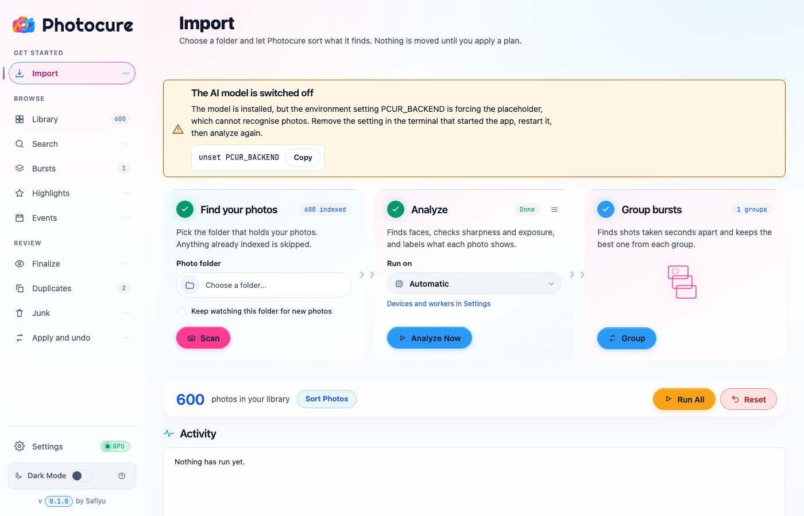
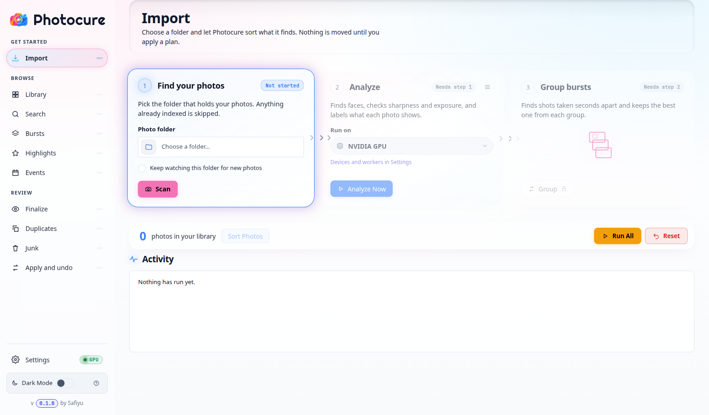

<p align="center"></p>

# Photocure Studio

**Sort, cull, edit and tidy your photo library, privately, on your own computer.**

Photocure looks at every photo, works out what it shows, finds the best shot in each burst, spots duplicates and clutter, and files everything into a clean folder structure. Nothing is uploaded, and nothing on your disk changes until you say so. Every move can be undone.

<p align="center">
  
  
</p>

## Contents

[What it does](#what-it-does) · [Install](#install) · [Day to day](#day-to-day) · [New, Library and Trash](#new-library-and-trash) · [The app](#the-app) · [Photo editor](#photo-editor) · [Shortcuts](#keyboard-shortcuts) · [Safety](#your-photos-stay-safe) · [Extras](#optional-extras) · [Command line](#command-line) · [Troubleshooting](#troubleshooting)

## What it does

- **Sorts photos by what they show:** people, food, animals, scenery, vehicles, buildings, products, art and more, with no manual tagging.
- **Finds the best photo in every burst**, including retakes taken hours apart and look-alikes with no capture time. Blinks are caught, and for group shots it names the frames to combine.
- **Finds duplicates**, identical or look-alike, and suggests which to keep.
- **Keeps reference shots apart:** receipts, whiteboards, screenshots, labels and medicine packaging go to a Utility tab.
- **Ranks your best photos** and builds balanced event stories.
- **Searches by description:** "dog on the beach".
- **Edits photos** with a built-in editor, and builds collages from burst frames.
- **Files your photos safely:** preview first, undo with one click.

Works with JPEG, PNG, WebP, TIFF, HEIC and common RAW formats (CR2, NEF, ARW, DNG). Libraries of 100,000 photos scroll smoothly.

**New in 2.x:** the [photo editor](#photo-editor), burst collages, **Reanalyse library**, **Finalize** buttons that move marked photos to the trash, and smarter burst detection.

## Install

You need a Mac, Linux or Windows computer, a few GB of disk for the AI model, and internet for the first set-up only (it runs offline afterwards). Apple Silicon and NVIDIA GPUs are much faster, but a plain processor works. Python 3.11+ is needed unless you use the Debian package or Docker.

**Debian or Ubuntu**

```bash
curl -LO https://github.com/safiyu/photocure/releases/latest/download/photocure_amd64.deb
sudo apt install ./photocure_amd64.deb
photocure setup
```

**Mac, Windows or any Linux (from source)**

```bash
git clone https://github.com/safiyu/photocure.git && cd photocure
python3 -m venv .venv
source .venv/bin/activate          # on Windows: .venv\Scripts\activate
pip install -e .
photocure setup
```

`photocure setup` picks the AI parts that fit your computer, downloads the model, checks everything works and opens the browser. It asks before downloading. Useful flags: `--yes`, `--dry-run`, `--cpu-only`, `--no-faces`, `--no-open`.

**Docker** (good for a NAS or server):

```bash
PHOTOS_DIR=/path/to/photos OUTPUT_DIR=/path/to/organized docker compose up
```

Open <http://localhost:8080/>. For GPUs add `-f docker-compose.gpu.yml` (NVIDIA, needs the NVIDIA Container Toolkit), `docker-compose.rocm.yml` (AMD) or `docker-compose.intel.yml`. The image sets `PCUR_LIBRARY_ROOT=/output/Organized`, so it never asks for a library folder. For Portainer or a home server use [docker-compose.stack.yml](docker-compose.stack.yml). Docker on a Mac cannot use the Mac GPU, so use the source install there.

## Day to day

Run `photocure start` (or `./start.sh`). Your browser opens at <http://localhost:8080/>. Stop with `Ctrl+C` or `photocure stop`. If asked to sign in, paste the one-time code printed in the terminal.

1. **Import:** pick your photo folder and press **Scan**.
2. **Analyze:** press **Analyze Now**. This is the slow step and you can keep browsing. Finished photos are never analyzed again.
3. **Look around:** Library, Bursts, Duplicates, Utility, Highlights.
4. **Tidy up:** fix uncertain photos in Finalize, choose which duplicates to keep.
5. **Organize:** in Apply and undo, choose Move or Copy, preview, apply.

For new photos later, press **Scan** then **Analyze Now**. A line under the library count always says what to do next.

## New, Library and Trash

The switch at the top right shows where your photos are.

- **New:** scanned but not applied yet. Analyze, tidy up and plan here.
- **Library:** finished photos in one folder, sorted by category. You can rename people, change a category (the file moves), edit or delete a photo. **Reanalyse library** runs the AI again on every library photo, finds bursts that were missed and refiles photos whose category changed, as one undoable step. Photos you sorted by hand, locked, marked for delete or that sit in a burst stay put. It can be stopped midway.
- **Trash:** removed photos, kept until you empty it. **Restore** them, **Return to origin** (they count as new again), **Reanalyse trash**, **Delete permanently** or **Empty trash**.

The library folder is chosen once on first run. To change it, press **Move library to another folder**: Photocure copies and verifies everything, switches over and leaves the old folder for you to delete.

## The app

- **Import:** choose a folder, **Scan**, **Analyze Now**, or **Run All**. Tick **Keep watching this folder** to pick up new photos automatically. The Activity panel logs everything. **Reset** clears Photocure's records only, never your files.
- **Library:** every photo, oldest first. Filter by category, camera, rating, country, favourites or date. Open a photo to rate, favourite, lock, recategorize, inspect faces, **Edit**, or **Mark for delete**.
  - **Mark for delete** is on every photo, section and the selection bar. Marked photos are dimmed and left out when you apply. With the trash option on (default) they go to Trash, otherwise they stay put. Nothing is deleted by marking. **Finalize** in any section moves its marked photos to Trash.
  - **Clean export** makes share-safe copies: location and camera details removed, neutral names, optional web gallery. It can also blur or skip license plates, payment cards, screens, house numbers and ID documents. It is a helper, not a guarantee, so check what you share.
- **Search:** describe what you want in your own words.
- **Bursts:** every burst with the best frame marked and faces checked for closed eyes. For group shots, if no frame is perfect it names two frames to combine: **Create fixed photo** blends the open eyes into the best frame (`IMG_xxxx_fixed.jpg`), and **Export layered PSD** gives aligned layers for hand touch-ups. **Make best shot** overrides the pick. **Reject all blinks** sends blink frames to Junk review.
  - **Make collage** combines 2 to 5 frames into one image with per-cell pan and zoom. You choose layout and export size (up to 4K) and it saves a new photo.
  - **Finalize** on a burst (or **Finalize all**) moves frames marked for delete to Trash and keeps the rest in the library.
- **Highlights:** best photos first, blending appeal with your stars and favourites. **Tune the ranking** sets the weights and **Learn from my ratings** learns your taste. Views: all, best of each event, or balanced event stories. **Year in review** downloads a shareable web page.
- **Events:** groups photos by time and place. Set the hours and kilometres apart, press **Find events**, rename freely.
- **Utility:** receipts, notes, screenshots, labels, parking signs, packaging. Filter to one kind.
- **Finalize:** photos Photocure was unsure about. Press a number to pick a category, then **Learn from my choices** to re-sort the rest.
- **Duplicates:** each photo is **Keep** or **Duplicate**. **Keep this one instead**, **Accept all suggestions**, or **Not duplicates**.
- **Junk:** duplicates, memes, very dark or blurry shots and unreadable files. Move anything back to a real category.
- **Apply and undo:** choose **Move** or **Copy**, **Rebuild plan**, **Preview changes**, **Review and apply**. **Undo this change** restores every file. **Verify files** and **Repair paths** fix mismatches if you moved folders yourself.
- **Settings:** library folder, default Move or Copy, processing device, workers, file name collisions (never overwrites), keywords for digiKam or Lightroom, About, Restart, Reset library and Dark Mode.

## Photo editor

Press **Edit** in the photo viewer. Edit the photo, then **Save**, or **Download**. Tools are grouped along the bottom: **Adjust**, **Annotate** and **Tools**.

| Tool | What it does |
|---|---|
| Crop & Rotate | Aspect crops, 90 degree turns, flips, fine rotate |
| Light | Brightness, contrast, saturation |
| Looks | 8 looks (Vivid, Portrait, Film, Cinematic, Golden, Matte, Mono) with a Strength slider. No hue shifts, so skin stays natural |
| Remaster | AI denoise, low-light correction and super-resolution |
| Detail, Red-Eye | Blur and sharpen, fix red eyes |
| Remove BG | AI background removal, with a basic cutout fallback |
| Draw, Stickers | Pen, highlighter, eraser, emoji stickers |
| ID Card, QR Code | Print-ready ID layout, QR generator |
| OCR | Read text from the photo |

- **One Apply bar.** Crop, Light, Looks and Detail preview live; **Apply** and **Cancel** appear at the bottom of the panel. Switching tool applies what you were doing, so nothing is lost, and Undo still works.
- **Compare** (button or **C**) shows a draggable split between the original and your edit.
- The zoom control in the corner has zoom in and out, **Fit** and **1:1**.
- Undo and redo keep the last 10 steps.
- **Save** offers **Save as copy** (writes `name_edited.ext` next to the original as a new photo) or **Overwrite original**, which replaces the file, refuses RAW and HEIF, and stops without touching the file if the format cannot be converted. **Download** asks for a format and quality and does not change your library.
- Editing runs on a canvas capped at 4K.
- OCR works best with `pip install "photocure[ocr]"`; without it Photocure uses Tesseract if installed.

## Keyboard shortcuts

Press **?** in the app for this list.

| Key | What it does |
|---|---|
| Arrow keys, Enter or Space | Move around, open the highlighted photo |
| **1** to **5**, **0** | Rate with stars, clear the rating |
| **x**, **f**, **l** | Reject, favourite, lock (each toggles) |
| **j** and **k** | Next and previous photo in Finalize and Junk |
| **1** to **9** | In Finalize and Junk: choose a category |
| **u** | Undo the last category change |
| Esc | Close the large view or a dialog |

## Your photos stay safe

- Nothing moves until you press Apply, after a preview. Every change can be undone exactly.
- Removed photos wait in Trash until you empty it. Scanning, analyzing, rating and reviewing never touch your files.
- Nothing is overwritten except when you choose **Overwrite** in the editor. Rejecting never deletes.
- Ratings and rejects are saved in `.xmp` sidecar files other programs understand. Photocure asks before replacing a file another program changed. Set `PCUR_WRITE_SIDECARS=false` to keep ratings inside Photocure only.
- Everything runs locally. Your photos are never uploaded.

## Optional extras

**Place names.** `photocure geocode` fills in city, region and country for photos with GPS, offline.

**Your own categories.** Extend or reword the built-in categories with a small YAML or JSON file. New rules apply to photos analyzed afterwards.

```bash
export PCUR_TAXONOMY_FILE=/full/path/to/my_categories.yaml
```

```yaml
classes:
  - name: concert
    folder: Events/Concerts        # where its photos are filed
    group: people                  # look-alike classes share a group
    date_grouped: true             # add year/month/day folders
    prompts:                       # what the AI should look for, in plain words
      - a concert with a stage and bright lights
```

Describe the photo with a few sentences and avoid "no people": the AI reads the words, not the negation.

**Ask an AI agent about your photos.** An MCP server lets an agent such as Claude search your library, view photos, fix blinks or make a clean export. It runs locally and can only add new files, never change, move or delete existing photos. It has ten tools: eight read-only (overview, search, browse, photo details, view a photo, list bursts) and two that write new files (`create_composite`, `clean_export`).

```bash
pip install "photocure[mcp]"
claude mcp add photocure -- photocure mcp --db /full/path/to/photocure.db
```

## Command line

| Command | What it does |
|---|---|
| `photocure setup` / `start` / `stop` | Set up, start or stop Photocure |
| `photocure search "dog on the beach"` | Find photos by description |
| `photocure highlights --year 2024 --top 50 --out DIR` | Year-in-review page (`--copy` copies originals) |
| `photocure keywords` | Write keywords next to photos (`--remove` undoes) |
| `photocure geocode` | Add place names |
| `photocure mcp --db FILE` | Run the agent server |
| `photocure doctor` / `devices` | Check the model and GPU, list usable devices |
| `photocure plan` / `apply` | Build and apply a plan (`--library-root DIR`, `--operation move\|copy`) |
| `photocure trash-purge` | Permanently delete everything in the trash |
| `photocure version` | Show the version |

`photocure start` also takes `--port 9000` and `--no-open`.

## Troubleshooting

- **"The AI model is switched off":** a `PCUR_BACKEND` setting forces the placeholder. Run `unset PCUR_BACKEND` (on Windows remove the variable), restart, and re-run **Analyze Now**.
- **It needs the AI model:** run `photocure setup` once. Search, Event stories and Analyze need it.
- **The page asks for a code:** copy it from the terminal. `photocure start` opens the browser already signed in.
- **Port in use:** Photocure picks the next free port and tells you. Free the old one with `photocure stop`.
- **Analysis is slow:** a supported GPU or Apple Silicon is much faster. Check `photocure devices` and Settings, Processing device.
- **Anything else:** run `photocure doctor`.

---

Photocure is released under the MIT license.
