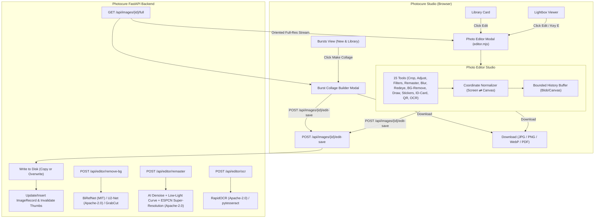

# Implementation Plan: Merging Ranthal Photo Editor into Photocure Studio
*(Hardened against Ranthal's known bugs, coordinate shifts, and memory leaks)*

This plan outlines how Ranthal's image-editing suite is ported, hardened, and merged directly into **Photocure Studio**.
Users can click **Edit** on any photo in the Library (or in the Lightbox viewer), edit it with all single-photo editing tools, and save it back to the Library (as a new copy or overwriting the original) or download it.
The **Collage Maker** is merged directly into the **Bursts section** (available in both New and Library stages) to generate collages from burst frames.

---

## 1. Audit of Ranthal Bugs & Engineering Safeguards

Before porting, a deep inspection of Ranthal's codebase identified critical bugs and fragile patterns. The table below lists these issues and how Photocure will solve them:

| Area | Ranthal Bug / Defect | Photocure Safeguard & Solution |
| :--- | :--- | :--- |
| **Action Replay Desync** | Tools like Drawing, Red-Eye, Remaster, BG Removal, QR Code, and ID Card updated `processedSrc` directly without logging to `actions`. When saving/downloading, `replayActions` re-executed `actions` from `originalSrc`, **wiping out all unlogged edits**. | **Single Canvas Pipeline**: Every committed tool operation bakes directly into the working canvas buffer. No dual-track split between "actions" and "baked data". |
| **Coordinate Mismatch** | Drawing, stickers, and crop used DOM/screen pixel coordinates (`clientX`, `stickerPos.x`) divided directly by natural dimensions without accounting for CSS scaling or pan/zoom offsets. Edits shifted or warped on export. | **Strict Coordinate Normalizer**: Implement `screenToCanvas(x, y)` and `canvasToScreen(x, y)` factoring in `naturalWidth`, `displayedWidth`, canvas offset, and current pan/zoom. |
| **Memory Leaks & OOM** | Storing full-res base64 DataURLs (20–50MB each) in an unbounded history array caused `OutOfMemory` crashes on mobile/desktop browsers. | **Memory-Capped Undo Buffer**: Limit undo history to 10 states. Store history as compressed binary Blobs or lightweight undo deltas. Clean up all object URLs with `URL.revokeObjectURL()`. |
| **Division by Zero (Remaster)** | `(255 / (maxR - minR))` in histogram stretching crashed with `Infinity`/`NaN` on flat, solid-color, or low-contrast images, turning photos completely black. | **Safe Clamping**: Guard with `Math.max(1, maxR - minR)` and use 1%–99% percentile clipping to prevent single noisy pixels from breaking dynamic range. |
| **Unbounded Convolutions** | JavaScript 3x3 convolution loops for sharpen/blur processed 8+ million pixels on the main thread, freezing the UI for several seconds. | **Hardware Acceleration & Web Worker**: Use native canvas `ctx.filter` for preview. Execute heavy raster processing with progress feedback and throttling. |
| **Double EXIF Rotation** | Ranthal parsed EXIF in browser and rotated via canvas. Photocure already serves EXIF-corrected upright images via `load_image`. Doing both caused 180°/90° flipped photos. | **Single Source of Truth**: Backend `/api/images/{id}/full` delivers already-oriented pixels (`orientation=1`). Client never re-applies EXIF rotation. |
| **Hanging Promises** | `createImage()` and `toDataURL()` in Ranthal lacked `img.onerror` or timeout handlers. Corrupt files or network dropouts hung the UI forever. | **Defensive Promises**: All image loader promises must have explicit `onerror` rejection and a 15-second timeout with user toast errors. |
| **Hardcoded Dimensions** | Collage hardcoded to `1200x1200px`; ID card fixed to `1240x1754px`, downsampling high-res library photos. | **Configurable Resolution**: Dynamic canvas sizing preserving original source resolution (up to 4K / 3840px for web export). |

---

## 2. System Architecture & Data Flow

---

## 3. Backend Implementation (`photocure/`)

### 3.1 New Module: `photocure/editor_actions.py`
1. **`get_oriented_image_stream(db_path, image_id)`**:
   - Resolves the existing path (`path` or `target_path`).
   - Opens via Photocure's `load_image` (handles JPEG, PNG, WebP, HEIC/HEIF via `pillow-heif`, and RAW via `rawpy`).
   - Normalizes orientation to standard upright (orientation=1).
   - Returns bytes + MIME type.
2. **`save_edited_image(db_path, cfg, image_id, image_bytes, mode, format)`**:
   - `mode == "copy"`:
     - Derives a new filename: `{stem}_edited{ext}` (e.g. `DSC_0042_edited.jpg` or `DSC_0042_edited_2.jpg` if collision).
     - Writes file atomically to the same directory as the original.
     - Indexes the file in the database: inherits original's `stage` (`library` or `new`), `category`, `subcategory`, `taken_at`, `gps_lat`, `gps_lon`, `is_favorite`.
     - Generates thumbnail in `cache_dir / "thumbs"`.
   - `mode == "overwrite"`:
     - Replaces existing file on disk atomically.
     - Updates `file_size`, `file_mtime`, `quick_hash`, `sha256`, `width`, `height`, and resets `orientation = 1`.
     - Purges thumbnail cache entries (`micro`, `medium`, `preview`) so UI refreshes immediately.
3. **`remove_background(image_bytes, model_name="birefnet-general")`**:
   - Uses `BiRefNet` (`birefnet-general`, MIT License) or `U2-Net` (`u2net`, Apache-2.0 License) via `rembg` ONNX runtime with an explicit permissive-license allowlist.
   - Robust fallback to OpenCV `cv2.grabCut` + morphology mask for guaranteed offline operation.
4. **`remaster_image(image_bytes, denoise=True, low_light=True, upscale=True)`**:
   - 3-stage AI & computational photography remaster chain:
     - Stage 1: Chroma & Luminance AI/Edge-Preserving Denoising (LAB bilateral chroma + Non-Local Means luminance).
     - Stage 2: Low-Light & Exposure Correction (Zero-DCE iterative quadratic illumination curve + CLAHE + auto-levels + vibrance).
     - Stage 3: AI Super-Resolution & Detail Restoration (`super_resolution_espcn.onnx`, Apache-2.0 Sub-Pixel CNN on luminance channel).
5. **`extract_text(image_bytes)`**:
   - Uses `RapidOCR` (`rapidocr-onnxruntime`, Apache-2.0 PaddleOCR v4 ONNX) with fallback to `pytesseract`.

### 3.2 FastAPI Routes in `photocure/ui/app.py`
- `GET /api/images/{image_id}/full`: Stream oriented full-res image.
- `POST /api/images/{image_id}/edit-save`: Authenticated save endpoint (`mode="copy" | "overwrite"`).
- `POST /api/editor/remove-bg`: Authenticated background removal endpoint (`BiRefNet` MIT).
- `POST /api/editor/remaster`: Authenticated 3-stage AI remaster endpoint.
- `POST /api/editor/ocr`: Authenticated text extraction endpoint (`RapidOCR` Apache-2.0).

---

## 4. Frontend Implementation (`photocure/ui/static/`)

### 4.1 Native Photo Editor Studio (`editor.mjs` & `index.html`)
- Standalone ES Module loaded dynamically when user clicks Edit.
- **Single Canvas Model**:
  - Primary working canvas maintains true image pixels.
  - Interactive overlay canvas handles live drawing, crop boundary selection, sticker placement, and QR code manipulation with exact coordinate normalization.
- **Included Tools (Single Photo)**:
  1. **Crop & Aspect Ratio**: Free, 1:1, 4:3, 16:9, 3:2, 9:16 with boundary clamping (no out-of-bounds `IndexSizeError`).
  2. **Transform**: Rotate 90° CW/CCW, fine slider rotation, Flip Horizontal, Flip Vertical.
  3. **Adjustments**: Brightness (50–150%), Contrast (50–150%), Saturation (0–200%).
  4. **Filters**: 33 presets (Classic + Social). Live preview applied via CSS filter during selection; baked to canvas on apply.
  5. **Remaster**: Auto-levels with zero-division safeguard + 1%–99% percentile stretch + 15% saturation + mild sharpen.
  6. **Blur & Sharpen**: Interactive blur/sharpen sliders with throttled preview.
  7. **Red-Eye Fix**: Click on pupil with adjustable radius and RGB desaturation.
  8. **Background Removal**: AI background removal with sticker stroke outline (`cartoonize`), transparency trim, and noise despeckle.
  9. **Draw & Annotate**: Pen, Highlighter (multiply blend), Eraser, Color picker, Brush size.
  10. **Stickers**: Emojis (Fun, Nature, Objects, Signs) + Custom Stickers saved in browser storage. Draggable, resizable, rotatable.
  11. **ID Card Maker**: A4 150 DPI layout for Front & Back photos with independent scaling.
  12. **QR Code Generator**: Wi-Fi, vCard, URL, Text, Phone, Email, SMS, Geo overlay.
  13. **OCR**: Copy extracted text to clipboard.
  14. **Compare Mode**: Hold "Compare" button to temporarily view unedited original.
  15. **Save & Export**:
      - **Save as Copy** (adds new photo to Library).
      - **Overwrite Original** (updates existing photo in Library).
      - **Download** (JPEG, PNG, WebP, PDF).

### 4.2 Burst Collage Builder (Bursts Tab — New & Library)
- Located in `showBurst` toolbar (`#blinkbar`) and `#bulkbar` when viewing bursts.
- Clicking **Make collage**:
  - Opens the Burst Collage modal pre-filled with the burst's frames.
  - Allows selecting 2 to 5 frames from the burst.
  - Choose layouts: `2-split-v/h`, `3-cols/rows/left-main/top-main`, `4-grid/cols/rows`, `5-grid-mixed/cols`.
  - Individual frame pan and zoom (1x to 3x) inside each grid cell with strict boundary clipping.
  - **Save Collage to Library**: Calls `/api/images/{best_id}/edit-save` with `mode="copy"`, assigning it to the burst.
  - **Download**: Saves high-resolution collage directly to user's device.

### 4.3 UI Triggers in Library & Lightbox
- **Library Grid Cards**: Add an **Edit** button with icon (`data-edit="${id}"`) in the card action bar.
- **Lightbox**: Add an **Edit** button in `#lb-actions` and register shortcut <kbd>e</kbd> to launch the Editor Studio.

---

## 5. Verification & Testing Plan

1. **Backend Tests (`tests/test_editor_actions.py`)**:
   - `test_get_oriented_image_stream`: verify EXIF orientation normalization.
   - `test_save_edited_image_copy`: verify new file creation, DB row insertion, metadata inheritance, and non-collision naming.
   - `test_save_edited_image_overwrite`: verify in-place overwrite, hash/mtime update, and cache invalidation.
   - `test_remove_background_fallback`: test GrabCut fallback when deep-learning models are absent.
2. **Frontend Bug Regression Tests**:
   - Test Draw + Filter + Crop combined: verify drawing is not erased by subsequent filter or crop.
   - Test Remaster on solid-white and solid-black images (verifying no `NaN`/`Infinity` division).
   - Test Sticker placement under high zoom & pan: verify sticker appears exactly where placed on export.
   - Test 10 consecutive edits: verify memory does not balloon and undo/redo traverses smoothly.
   - Test Burst Collage: verify generating collage from 3 burst frames and saving back to Library.
