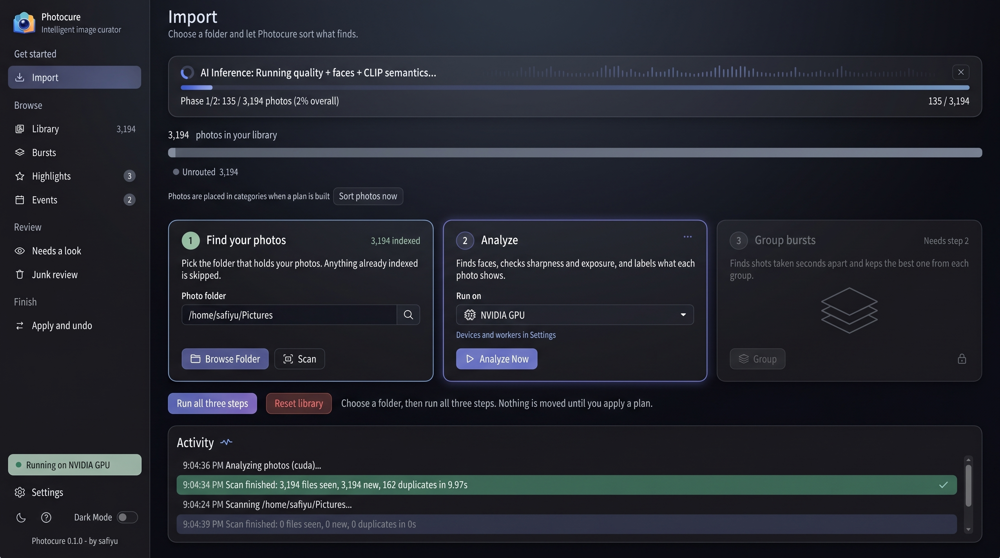
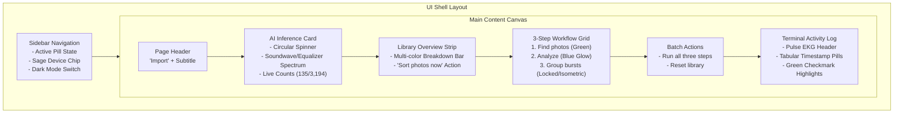

# UI Revamp Specification: Modern Cyberpunk & Dark-Slate Interface



---

## 1. Overview & Objectives

This specification details the frontend revamp for **Photocure**, adapting the interface directly from the refined mockup in [new.jpeg](file:///home/safiyu/Downloads/new.jpeg) (bundled locally at [docs/ui_mockup.jpeg](file:///home/safiyu/Projects/photocure/docs/ui_mockup.jpeg)).

The target interface replaces the flat dark theme with a sophisticated dark-slate aesthetic featuring:
- **Atmospheric Glow & Focused State Hierarchy**: Clear visual focus on active steps (e.g. Step 2 "Analyze" with electric-blue border and soft atmospheric glow).
- **AI Inference Soundwave / Equalizer Spectrum**: A frequency equalizer visualizer integrated directly into the progress notification card.
- **Three-Column Workflow Engine**: High-affordance cards for Scan (Completed/Sage Green), Analyze (Active/Electric Blue), and Group Bursts (Pending/Isometric Stack Illustration).
- **Modernized Dark Mode Sidebar**: Enhanced navigation capsule pills, device chip with glowing green status dot, and a hardware-style sliding Dark Mode toggle switch.
- **Terminal Activity Feed**: Event stream with tabular timestamp pills (`.time-pill`), active row status highlighting, and inline completion glyphs.



---

## 2. Design System & CSS Token Architecture

To maintain compatibility with existing tests ([test_c5_ui.py](file:///home/safiyu/Projects/photocure/tests/test_c5_ui.py)), existing base variables are preserved while adding extended tokens:

| Token Name | Value | Purpose |
| :--- | :--- | :--- |
| `--canvas-bg` | `#0b0e14` | Ultra-deep obsidian background |
| `--sheet` | `#131926` | Elevated card & panel surface |
| `--sheet-border` | `#1e2638` | Subtle component outline |
| `--accent-electric` | `#3b82f6` | High-visibility cobalt blue accent |
| `--accent-glow` | `0 0 20px rgba(59, 130, 246, 0.28)` | Focus glow for active tasks |
| `--ok-sage` | `#22c55e` | Soft green for completed states |
| `--ok-sage-bg` | `#14291f` | Completed chip background |
| `--danger-crimson` | `#ef4444` | Red for library reset & errors |
| `--danger-crimson-bg`| `#261619` | Destructive button background |
| `--viz-bar` | `#38bdf8` | Equalizer frequency bar color |

---

## 3. Component Breakdown

### 3.1 Sidebar Navigation
- **Active Navigation Pill**:
  - `background: rgba(59, 130, 246, 0.16)`
  - `border: 1px solid rgba(59, 130, 246, 0.3)`
  - White icon and bold text.
- **Count Badges**: Muted pill containers with monospace tabular numbers.
- **Device Status Chip**:
  - Capsule pill: `border: 1px solid rgba(34, 197, 94, 0.35); background: #14291f`
  - Glowing status dot `•` with animated pulse.
  - Text: `Running on NVIDIA GPU`.
- **Hardware-Style Dark Mode Switch**:
  - Semantic toggle: `<label class="switch"><input type="checkbox" id="theme-switch" checked><span class="slider"></span></label>`
  - Smooth 0.2s slide transition.

### 3.2 AI Inference Card & Equalizer Spectrum
- **Layout**: Full-width rounded card with dark slate background (`#131926`).
- **Equalizer Spectrum**:
  - Responsive container containing 24–32 vertical bars (`.spectrum-bar`).
  - Animated with CSS wave keyframes (`@keyframes eq-pulse`).
  - Automatically disables on `@media (prefers-reduced-motion: reduce)`.
- **Metrics**: Real-time counter `135 / 3,194 photos (2% overall)` and close button `[✕]`.

### 3.3 Three-Step Workflow Cards
```
┌─────────────────────────┐  ┌─────────────────────────┐  ┌─────────────────────────┐
│ (1) Find your photos    │  │ (2) Analyze         ··· │  │ (3) Group bursts        │
│            3,194 indexed│  │                         │  │             Needs step 2│
│                         │  │                         │  │                         │
│ Photo folder            │  │ Run on                  │  │     ┌─────────────┐     │
│ [/home/safiyu/Pic... Q] │  │ [ [*] NVIDIA GPU     v] │  │   ┌─┴───────────┐ │     │
│                         │  │                         │  │ ┌─┴───────────┐ │ │     │
│ [ Browse Folder] [ Scan]│  │ [ ▷ Analyze Now ]       │  │ [ Group ]           (L) │
└─────────────────────────┘  └─────────────────────────┘  └─────────────────────────┘
   State: Completed (Green)     State: Active (Blue Glow)    State: Pending (Isometric)
```

- **Step 1 ("Find your photos")**:
  - Green circular badge `(1)`.
  - Folder input field with search magnifying glass on trailing edge.
  - Buttons: `[📁 Browse Folder]` (slate blue) + `[📷 Scan]`.
- **Step 2 ("Analyze")**:
  - Electric-blue active border with soft atmospheric glow.
  - Device selector dropdown chip (`[ microchip icon | NVIDIA GPU | ▼ ]`).
  - Action button: `[ ▷ Analyze Now ]`.
- **Step 3 ("Group bursts")**:
  - Muted/locked appearance (`opacity: 0.55`).
  - Centered isometric wireframe SVG representing 3 stacked photos.
  - Action button: `[ ☵ Group ]` with lock glyph `🔒` on the right edge.

### 3.4 Terminal Activity Feed
- **Header**: Pulse / EKG heartbeat wave icon 〽️ (`#60a5fa`).
- **Timestamp Badges**: Tabular monospace pills (`.time-pill.info`, `.time-pill.ok`, `.time-pill.muted`).
- **Completed Job Highlighting**:
  - Rows like `Scan finished: 3,194 files seen...` receive an active green border, green tint, and trailing checkmark `✓`.

---

## 4. Implementation Steps & File Modifications

1. **`photocure/ui/static/style.css`**:
   - Add new color tokens, glowing step card styles, and equalizer keyframes.
   - Add toggle switch CSS and terminal `.time-pill` formatting.
   - Add responsive breakpoints for small screens.
2. **`photocure/ui/static/index.html`**:
   - Update sidebar footer with the sliding switch.
   - Insert equalizer container inside `#progress-card`.
   - Update 3-step card HTML structure with new icons, input search glyph, and 3D burst SVG.
3. **`photocure/ui/static/app.js`**:
   - Enhance `renderProgress` to activate/pause the equalizer animation.
   - Update `logLine` to wrap timestamps in styled `.time-pill` elements and add completion checkmarks.
   - Wire the toggle switch to theme changes.
4. **Verification**:
   - Run `.venv/bin/pytest tests/test_c5_ui.py tests/test_ui.py`.
   - Validate WCAG 2.1 AA color contrast and keyboard navigation.
